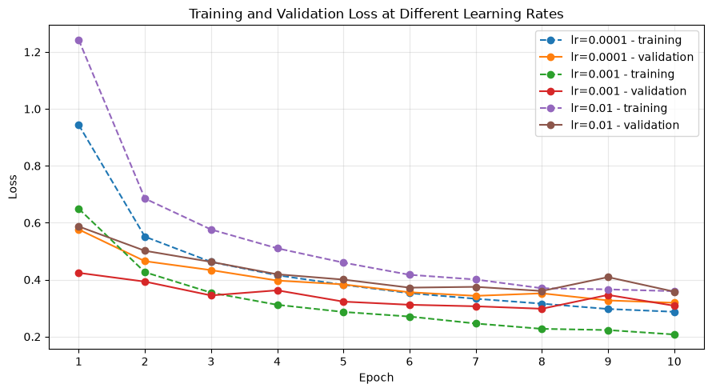
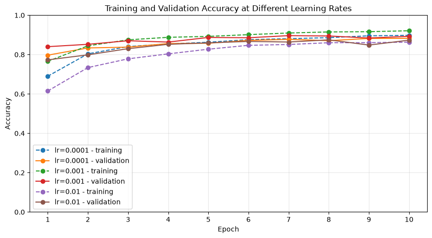

# How Learning Rate Shapes the Training of a Small CNN on Fashion-MNIST

**Student:** Kayla Nicole Jade T. Abris  
**Course:** DS4A  
**Date:** November 18, 2026

## Introduction

Training a deep learning model involves choosing settings that affect how the model learns. One important setting is the **learning rate**. It controls how large the optimizer's updates to the model's weights are after the model calculates its prediction error. The learning rate can affect how quickly a model learns and how well it performs on data it has not seen during training.

If the learning rate is very small, the model makes small updates. This can make learning gradual and may require more training time. If the learning rate is too large, the updates may move past useful values, making training less stable. Because of this, choosing a suitable learning rate is an important part of training a neural network.

For this activity, I explored the question: **How does changing the learning rate affect the training loss, validation loss, and validation accuracy of a small Convolutional Neural Network (CNN) trained on Fashion-MNIST?** I compared three learning rates and kept the other main settings the same.

## Dataset and experiment setup

I used the Fashion-MNIST dataset. It contains 70,000 grayscale images of clothing items. Each image is 28 by 28 pixels and belongs to one of 10 clothing categories. The dataset has 60,000 images in its training portion and 10,000 images in its separate test portion.

To keep the experiment manageable, I used 10,000 images for training and 6,000 images for validation, selected from the original training portion. The separate 10,000-image test set was not used to choose the learning rate. This helped keep the comparison focused on validation performance.

The model was a small CNN with two convolutional blocks, batch normalization, ReLU activation, max pooling, dropout, and fully connected layers. It had **421,834 trainable parameters**. I used the Adam optimizer and cross-entropy loss for the 10-class classification task.

The three learning rates were **0.0001, 0.001, and 0.01**. Each run used a batch size of 64, 10 epochs, and random seed 42. Data augmentation and a learning-rate scheduler were turned off. The CNN architecture, data split, optimizer, and other settings stayed the same. Therefore, the learning rate was the main setting changed between runs.

## Results

The experiment completed all 10 epochs for each learning rate. The table summarizes the best validation accuracy and lowest validation loss recorded during each run.

| Learning rate | Best validation accuracy | Lowest validation loss | Final training loss | Final validation loss |
|---:|---:|---:|---:|---:|
| 0.0001 | 88.27% | 0.3188 | 0.2873 | 0.3188 |
| **0.001** | **89.63%** | **0.2979** | **0.2076** | **0.3085** |
| 0.01 | 87.48% | 0.3581 | 0.3596 | 0.3581 |

**Figure 1.** Training and validation loss across 10 epochs. Dashed lines show training loss, and solid lines show validation loss.

The validation-loss curve for 0.001 reached the lowest value, 0.2979. Its loss decreased through most of training and stayed lower than the other validation curves near the end. The 0.0001 setting improved more gradually and finished with a validation loss of 0.3188. The 0.01 setting started with the highest loss and showed a noticeable increase around epoch 9 before decreasing again at epoch 10.

**Figure 2.** Training and validation accuracy across 10 epochs. Dashed lines show training accuracy, and solid lines show validation accuracy.

All three settings improved in accuracy during training. The 0.001 setting reached the highest validation accuracy of 89.63%. Its final validation accuracy was 89.27%. The 0.0001 setting reached 88.27%, while 0.01 reached 87.48%. This shows that the largest learning rate did not produce the best validation result, even though it made progress during training.

## Discussion

Based on the results, **0.001 performed best overall** among the three learning rates tested. It achieved the highest validation accuracy and the lowest validation loss. This suggests that it provided a useful balance between making progress and avoiding overly large weight updates for this particular CNN and dataset setup.

The smallest learning rate, 0.0001, also performed well. Its loss decreased gradually, which is consistent with the smaller weight updates made by a lower learning rate. However, after 10 epochs, its validation results were slightly lower than those of 0.001. It is possible that it could improve with more training, but that would need another experiment to confirm.

The largest learning rate, 0.01, had the lowest validation accuracy and highest minimum validation loss among the three settings. Its validation-loss curve was less consistent near the later epochs. A possible explanation is that larger updates made it harder for the model to settle on useful weight values. This is consistent with the general idea that a learning rate that is too large can make training less stable.

There was also a gap between training and validation performance for 0.001. Its final training loss was 0.2076, while its final validation loss was 0.3085. This suggests that the model learned the training examples better than the held-out validation examples. It may indicate some overfitting, although the validation accuracy remained high. This is why it is important to look at validation results and not only training accuracy or training loss.

## Limitations

This experiment has some limitations. First, it used 10,000 training images instead of the full 60,000-image training portion. Second, each learning rate was tested with only one random seed, so a different initialization or data order could affect the results. Third, only three learning rates were compared, and all runs used Adam for 10 epochs. A different optimizer, model, or training duration could lead to different results. The separate test set was not used in this comparison. A future experiment could repeat each learning rate with several seeds, test more values around 0.001, and evaluate the final selected model on the test set after choosing the hyperparameter.

## Conclusion

This experiment showed that the learning rate affects how a CNN trains and performs on validation data. Among the three settings tested, **0.001 achieved the strongest validation results**, with 89.63% best validation accuracy and 0.2979 lowest validation loss. The smaller value learned more gradually, while the larger value produced less consistent validation-loss behavior. For this specific experiment, 0.001 was the most suitable of the three tested values. More runs would be needed before making a broader conclusion.

## References

- Xiao, H., Rasul, K., & Vollgraf, R. (2017). *Fashion-MNIST: a Novel Image Dataset for Benchmarking Machine Learning Algorithms.* https://arxiv.org/abs/1708.07747
- PyTorch. (n.d.). *PyTorch documentation.* https://pytorch.org/docs/stable/index.html
- Lightning AI. (n.d.). *PyTorch Lightning documentation.* https://lightning.ai/docs/pytorch/stable/

## AI Use Acknowledgment

I used ChatGPT to help organize and review parts of this notebook and post, explain learning-rate concepts in simpler language, troubleshoot code and environment issues, and improve the wording of the discussion. I ran the experiment in my own environment and used the results generated by my notebook. I reviewed the explanations and results before including them. I will follow my instructor's requirements for permitted AI assistance and disclosure.

## Experiment Notebook

You can view the complete code and experiment here:

[View the Jupyter Notebook](How%20Learning%20Rate%20Shapes%20the%20Training%20of%20a%20Small%20CNN.ipynb) 
